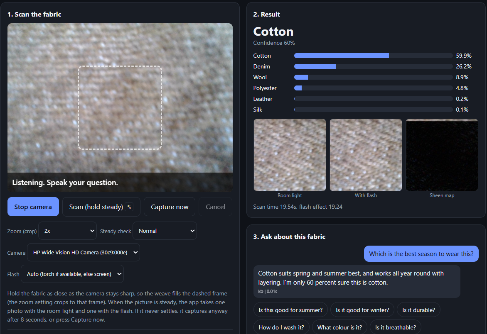

# Fabric Scanner: AI-Powered Fabric Identification for Visually Impaired Shoppers

A browser-based assistant that identifies a fabric from a camera scan and answers spoken follow-up questions.
Author: Sneha Sridhar (24BCE2103), School of Computer Science and Engineering, VIT.



## How it works
1. **Capture**: the browser waits until the picture is steady, then takes a room-light (flash-OFF) photo and a flash-ON photo
   (phone torch, or a full-screen white flash on a laptop).
2. **Classify**: a three-branch fusion network labels the fabric as Cotton, Denim, Silk, Wool, Polyester or Leather:
   - ResNet18 (spatial appearance)
   - Haar DWT + small CNN (texture frequencies)
   - Sheen CNN on the aligned flash-ON minus flash-OFF difference map
3. **Ask**: speak a question. Whisper transcribes it; a keyword/regex router answers from a curated knowledge base
   (`fabric_kb.py`). Visual or open questions fall back to Moondream2, grounded with the knowledge-base facts.
4. **Speak**: the answer is read aloud by the browser. An uncertainty note is added when confidence is under 70%.

Everything runs locally; no API key or cloud service is used.

## Results (iBUG Fabrics, 6 classes, 169 held-out test samples)
| Variant | Accuracy | Macro-F1 |
|---|---|---|
| Spatial only | 0.80 | 0.76 |
| + DWT | 0.78 | 0.73 |
| + Sheen | 0.80 | 0.75 |
| Full model | 0.82 | 0.76 |

The differences between variants are within the noise of a 169-sample test set. Class-weighted loss was the change that mattered
(macro-F1 0.65 to 0.76).

**Limitations:** accuracy on live webcam images is not validated (the model was trained on close-up sensor patches);
leather has few samples; no user study with visually impaired participants; Moondream2 is slow on CPU.
See `docs/Fabric_Scanner_Paper.pdf` for the full write-up.

## Setup
```bash
git clone https://github.com/<your-username>/fabric-scanner.git
cd fabric-scanner
python -m venv .venv
.venv\Scripts\activate          # Windows   (Linux/macOS: source .venv/bin/activate)
pip install -r requirements.txt
```
Whisper also needs **ffmpeg** (`winget install ffmpeg` on Windows, `sudo apt install ffmpeg` on Linux).
Check the setup with `python src/check_setup.py`.

## Dataset
Download the **iBUG Fabrics Dataset** (Imperial College London, https://ibug.doc.ic.ac.uk/resources/fabrics/) and keep the class folders
(Cotton, Denim, Silk, Wool, Polyester, Leather) in one directory, for example `archive/`. The dataset is not included in this repo.

## Train and evaluate
```bash
cd src
python train_ibug.py --data_dir ../archive --checkpoint model_full.pt
python evaluate_ibug.py --data_dir ../archive --checkpoint model_full.pt
python run_ablations.py --data_dir ../archive        # trains and evaluates all four variants
```
Model weights (`*.pt`) are not committed; train them with the commands above.

## Run the web app
```bash
cd src
python server.py --checkpoint model_full.pt --data_root ../archive
```
Open http://localhost:5000 in Chrome or Edge, press **Start camera**, then **Scan (hold steady)**.
Hold the fabric 10-15 cm from the camera with the weave filling the frame, in good light.

| Option | Meaning |
|---|---|
| `--no_vlm` | skip Moondream2 (faster start; visual/open questions disabled) |
| `--whisper_model base` | faster speech recognition |
| `--https` | serve over HTTPS so an Android phone can use camera, mic and torch (`pip install cryptography`) |
| `--mock` | interface test with no model (fake output, clearly labelled) |
| `--port 5001` | different port |

Without a camera, use **Scan a dataset sample**. Latency is written to `latency_log.csv` and scan images to `captures/`.

## Repository layout
```
src/
  server.py            Flask server and API
  pipeline.py          inference engine (classifier, Whisper, Moondream2, answer routing)
  fabric_kb.py         knowledge base and intent router
  model.py             three-branch fusion classifier
  dataset_ibug.py      data loading, ECC alignment, sheen difference map
  train_ibug.py, evaluate_ibug.py, run_ablations.py
  static/index.html    browser client (camera, steady trigger, flash, mic, speech)
  app.py               older terminal version (microphone/speaker via Python)
docs/                  paper (PDF) and figures
```

## Credits
iBUG Fabrics Dataset (Imperial College London), ResNet18 (torchvision), OpenAI Whisper, Moondream2 (vikhyatk).

## License
MIT. See `LICENSE`.
